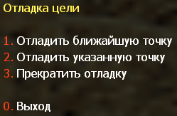

## Меню отладки цели

Чтобы проверить проходимость ботов до указанного узла, вам нужно открыть вторую страницу меню "Редактор графов" и выбрать **1. Отладка цели**. Затем должно появиться меню, как показано на картинке ниже.

| Опция | Описание |
|--------|----------|
| **1. Отладить ближайшую точку** | Назначить ближайший узел целью, которую должен достичь бот |
| **2. Отладить указанную точку** | Назначить узел под прицелом целью, которую должен достичь бот |
| **3. Прекратить отладку** | Отключить функцию отладки цели |
